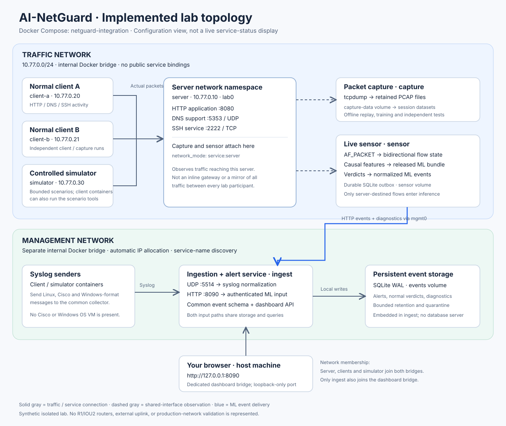

# AI-NetGuard

AI-NetGuard combines network-flow ML verdicts and normalized device logs in one
local alert console. This branch implements an isolated, reproducible Docker
validation environment. It is not a production-validated IDS.



[Open the full-size topology](docs/network-topology.svg) ·
[Detailed packet-to-alert and model-release workflow](docs/network-workflow.svg)

## Quick start

Use Linux, Docker Engine, Compose supporting `interface_name`, and Python 3.11.
Docker capture requires Linux packet sockets. Rootless Docker and Docker Desktop
have not been validated.

```bash
python3.11 -m venv .venv
.venv/bin/pip install -r network-anomaly-detection/requirements.txt
export NETGUARD_TOKEN="$(openssl rand -hex 24)"
make lab-up
make demo PYTHON=.venv/bin/python
```

Open <http://127.0.0.1:8090> and enter the same token in the console. The token is
kept in browser memory. The dashboard shows both normal observations and alerts;
the source filter separates syslog and ML. The demonstration uses real local
traffic, captured features and the shipped model, followed by an ingestion outage
and sensor restart. It also sends Linux, Cisco and Windows-format syslog messages.
Those messages simulate device log formats; there are no Cisco or Windows VMs.

```bash
make test PYTHON=.venv/bin/python
make lab-stop
```

Stopping the lab preserves named volumes. Do not remove volumes or original
captures unless their loss is intentional.

## Implementation

| Component | Entry point | Responsibility |
|---|---|---|
| Live sensor | `python -m netguard.sensor` | Linux packet capture, bounded flow lifecycle, inference, durable delivery |
| Ingestion and console | `python -m netguard.service` | HTTP ML input, UDP syslog, normalization, SQLite, dashboard |
| Legacy collector | `python logic.py` | Compatible standalone JSONL syslog collector |
| Offline flow replay | `src.streaming.replay_capture` | Same feature engine as live capture |
| Release training | `network-anomaly-detection/tools/train_release.py` | Capture-role validation, calibration, selection, evaluation, export |
| Session collection | `network-anomaly-detection/tools/collect_sessions.py` | Independent, bounded traffic runs with PCAP provenance |

The default loader resolves `models/releases/current.json`, validates the release
manifest, implementation hashes and runtime compatibility, then loads the
serialized preprocessing and classifier once. Original public-dataset models
and research candidates are retained separately.

The shipped `lab-v2` model covers **BENIGN, PORT_SCAN, HTTP_FLOOD and SLOW_HTTP**
under this lab's conditions. It does not replace validation of all CICIDS2017
attack classes. Its final independent-session novel-flow test had a **0.41%
false positive point estimate** on 981 eligible benign flows; the descriptive
95% Wilson interval was **0.16–1.04%**. Flows within a run are correlated, so this
is not a production or independent-run confidence guarantee.
See the actual [evaluation](network-anomaly-detection/reports/lab-v2/evaluation.json).

## Isolation and persistence

- Traffic and management bridges are internal. Traffic generators reject targets
  outside `10.77.0.0/24`. Clients have no external route.
- Only ingestion joins a separate dashboard bridge, because current Docker
  does not publish a port from an internal-only bridge. Its published port binds
  to host loopback. This bridge can provide ingestion with outbound connectivity;
  it is not attached to traffic generators.
- Capture and sensor share the server namespace and observe its interfaces.
  This is a server observation point, not a routed enterprise topology.
- Capture uses `NET_RAW`. The sensor runs as UID 0 with only `NET_RAW` to obtain
  its raw socket; a short unprivileged initializer grants its persistent volume
  group write access. Temporary link initializers use `NET_ADMIN` only to turn
  off packet coalescing in the isolated namespaces.
- Resource limits, read-only root filesystems, bounded queues and durable SQLite
  volumes constrain service state. Graceful shutdown flushes active flows.
  A crash loses in-memory partial flows, while queued durable events survive.

## Further instructions and evidence

- [Architecture, features and methodology](docs/architecture-and-validation.md)
- [ML and laboratory commands](network-anomaly-detection/README.md)
- [Engineering progress](docs/engineering-progress.md)
- [Technical report](docs/technical-report.md)
- [Large files kept outside Git (Drive)](docs/large-files.md)
- [Status and roadmap](docs/project-status-and-roadmap.md)
- [Topology](docs/network-topology.svg)

Historical reports and research notebooks are retained for context. Their random
flow splits and old capture-wide source-rate numbers are not release evidence.
